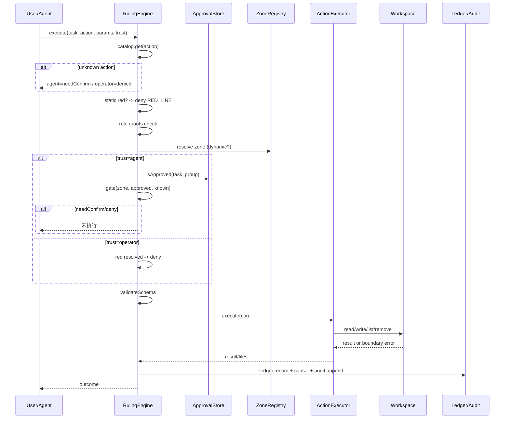

# 02 · 架构：分层与执行时序

## 1. 分层

```text
┌──────────────────────────────────────────────────────────────┐
│ 接口层  CLI · HTTP(127.0.0.1) · MCP(stdio) · SDK import        │
├──────────────────────────────────────────────────────────────┤
│ 提议层  Agent 循环 · Provider · 提示词 · 方言解析 · 会话        │
│         只产出动作提议，不掌握执行权                            │
├──────────────────────────────────────────────────────────────┤
│ 裁定层  RulingEngine                                          │
│         能力面登记 → 源头授权 → 区域解析 → gate()              │
│         数据边界 → 输入 schema → 观测                          │
├──────────────────────────────────────────────────────────────┤
│ 执行层  ActionExecutor（每包一个）                              │
│         只能通过 WorkspaceApi 访问文件                          │
├──────────────────────────────────────────────────────────────┤
│ 知识层  三层分离存储 · 外部源 · 哈希嵌入 · 图谱 · 冷热 · 因果链      │
├──────────────────────────────────────────────────────────────┤
│ 持久层  .ruling/config.json · state.json.gz · audit.jsonl      │
│         sessions/ · designs/ · 业务文件                         │
└──────────────────────────────────────────────────────────────┘
```

关键约束：**提议层不能调用执行层**。Agent 循环的每一个工具调用都必须经过 `RulingEngine.execute`。

## 2. 模块职责

| 模块 | 文件 | 职责 |
| --- | --- | --- |
| 能力面 | `core/catalog.ts` | 封闭动作表、分组、关键词匹配 |
| 区域 | `core/zones.ts` | 静态区域 + 动态解析器注册 |
| 门控 | `core/gate.ts` | 纯函数真值表 |
| 审批 | `core/approval.ts` | 任务绑定、角色、TTL、纯内存 |
| 效能 | `core/budget.ts` | 拉普拉斯平滑、速度/能耗分 |
| 台账 | `core/ledger.ts` | 尝试/成功/耗时/决策计数 |
| 审计 | `core/audit.ts` | 环形日志、哈希链、Markdown 导出 |
| 数据边界 | `core/workspace.ts` | 路径安全、格式锁、体积、原子写 |
| 校验 | `core/validate.ts` | 轻量 JSON Schema 子集 |
| 前置 | `core/planner.ts` | 分段、知识路由、候选动作、绿色直执行 |
| 执行入口 | `core/engine.ts` + `engine-{preflight,execute,plan,state,audit}.ts` | 唯一执行链、预检、计划建议、快照 |
| 知识 | `core/knowledge/*` | 三层分离、语义元数据/检索、外部源、图谱、冷热、gzip 状态 |
| 提议循环 | `agent/loop.ts` + `agent/context.ts` | Provider 调用、护栏、上下文预算 |
| Provider | `agent/provider.ts` | OpenAI 兼容 `/chat/completions` |
| 方言 | `agent/dialect.ts` | 正文 JSON/标签工具调用兜底 |
| 会话 | `agent/session.ts` | 原子 JSON 文档 |
| 适配器 | `adapters/*` | CLI/HTTP/MCP 投影 |
| 行业包 | `packs/*` | manifest + executor + 动态解析器 |

## 3. 一次执行的时序



门控顺序有意固定为：**能力面 → 红灯 → 角色授权 → 区域/审批 → 数据边界 → schema → 执行 → 观测**。被拒绝的操作不会先做磁盘访问；被批准的操作仍然要通过数据边界与 schema。

## 4. 大脑前置

`engine.prepare(task)` 是确定性函数：

1. **分段**：标点、换行、连接词，最多 8 段。
2. **知识路由**：哈希嵌入余弦 + 一跳邻接加成 + 类型先验（seed > error > extended）。
3. **候选动作**：动作关键词/标题匹配，加上知识单元 `uses` 边。
4. **分流**：
   - 唯一绿灯候选、分数 ≥ 2、无参、明显领先、无黄灯竞争 → `direct`，不经 LLM；
   - 其余交给 Agent 循环。

`PreparedContext` 注入系统提示，模型只在这个边界内提出调用。

## 5. Agent 循环

```text
prepare() → messages(system + history + task)
  └─ provider.chat(tools)
       ├─ 原生 tool_calls
       ├─ 正文 JSON/标签方言兜底
       └─ 无调用：完成/假完成守卫/空回复救援
  └─ 每个 tool_call → engine.execute
       ├─ needConfirm → 人机回调 → approve → 重试一次
       ├─ denied/error → 作为工具结果回喂
       └─ ok → 回喂结果，继续
```

护栏：

| 护栏 | 行为 |
| --- | --- |
| 最大轮次 | 默认 24 |
| 空回复 | 最多拉起 2 次 |
| 零工具“假完成” | 最多拉回 2 次 |
| 同参连续失败 | 2 次后短路 |
| 上下文预算 | 按 `contextK` 估算字符，裁最老的非 system 消息 |
| 工具结果上限 | 单条 4000 字符 |

护栏只影响“模型还能不能继续提议”，不改变任何执行权限。

## 6. 适配器

### 6.1 CLI

面向人：`--yes` 是显式批准；退出码 2 表示 `needConfirm`。因为审批只存运行态，CLI 不提供跨进程的 `approve` 命令。

### 6.2 HTTP

- 只绑定 `127.0.0.1`；
- `POST /execute` 默认 `operator` 信任；
- `POST /approve` 对同一运行进程生效；
- 可选 `x-ruling-token`，文档明确它不是鉴权；
- 请求体上限 1MB。

### 6.3 MCP

- stdio JSON-RPC；
- `initialize / tools/list / tools/call / ping`；
- 工具名把动作 id 中的点替换为下划线；
- `tools/list` 只暴露当前角色获授权的动作；
- **不提供 approve 工具**。

## 7. 持久化布局

```text
<workspace>/
├─ .ruling/
│  ├─ config.json        # pack/role/trust/provider/knowledge
│  ├─ state.json.gz      # 图谱 + 台账；不含知识单元与审批
│  ├─ knowledge/
│  │  ├─ seed.json       # 可选本地种子
│  │  ├─ experience.jsonl # extended
│  │  └─ errors.jsonl    # error / failure
│  ├─ audit.jsonl        # 哈希链审计
│  └─ sessions/*.json    # 会话
├─ designs/*.json        # 工业设计参考状态
└─ 业务文件...
```

权限状态（审批）不在任何持久化文件中。重启后必须重新批准。

## 8. 扩展点

| 扩展点 | 做法 |
| --- | --- |
| 新动作 | 在 pack manifest 登记 `ActionSpec` + 在 executor 实现 handler |
| 新区域规则 | `ZoneRegistry.register(key, resolver)`，在动作上写 `dynamicZone` |
| 新行业 | 新建 pack：manifest + executor + 知识种子 |
| 新模型 | 实现 `ChatProvider`，或直接用 OpenAI 兼容端点 |
| 新协议 | 复用 `RulingEngine`，把协议请求映射为 `ExecuteRequest` |
| 新持久化 | 替换 `KnowledgeStore.snapshot/restore` 与 `OutcomeLedger` |

## 9. 设计取舍

- **单包而非微服务**：最小可运行、易嵌入、易测试。需要拆分时按 `core / agent / packs / adapters` 切。
- **零运行时依赖**：只用 Node 内置模块，避免供应链与版本漂移。
- **哈希嵌入而非神经嵌入**：确定性、零依赖、无模型版本迁移；代价是语义天花板，用前置归一化与关键词补偿。
- **JSON 参考执行器而非真实 CAD**：保持可运行与可测试；真实系统替换 executor 即可。
- **MCP 最小子集**：只实现工具面，不实现资源/提示模板；足够验证外部 Agent 接入。
